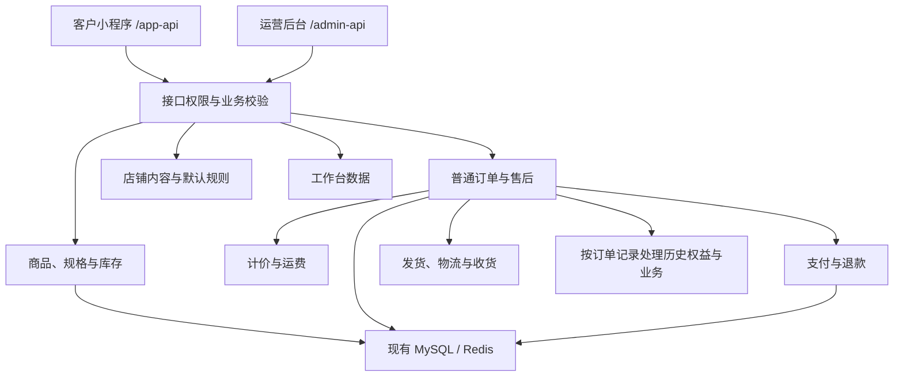

# Yuanmall 后端精简设计

- 版本：V1 设计草案
- 日期：2026-11-13（北京时间）
- 状态：待实施；本文不表示业务代码、数据库、定时任务或生产配置已经变更
- 经营模式：自营卖货，客户通过微信小程序直接购买
- 适用项目：`ruoyi-vue-pro`，配套服务小程序和 admin 的精简改造
- 关联文档：[商城总体设计](../../yudao-mall-uniapp/docs/DESIGN_YUANMALL.md)、[管理后台设计](../../yudao-ui-admin-vue3/docs/DESIGN_ADMIN.md)

## 1. 设计目标与边界

后端围绕普通商品购买、订单履约和售后运行，减少不再需要的新业务规则、运营配置和模块耦合。

沿用现有 Java 单体应用、MySQL、Redis、接口前缀和部署方式。小程序和 admin 使用同一组有效业务规则，默认值和关键校验由后端提供。

| 目标 | 设计结果 |
| --- | --- |
| 支撑商品单页发布 | 店铺默认值统一应用，普通商品只需提交必要业务信息 |
| 收敛新订单流程 | 新交易以普通商品、微信支付和主要履约方式为核心 |
| 简化计价 | 普通交易明确商品金额、运费和适用权益，逐步减少对无关营销能力的依赖 |
| 支撑运营工作台 | 提供可信、可核对且符合权限范围的待办和成交数据 |
| 保持交易完整 | 沿用库存、订单、支付、发货、收货和退款的有效处理规则 |
| 逐步裁剪依赖 | 先明确业务与历史兼容，再拆分组件、清理接口和构建依赖 |
| 保持可维护 | 保留总仓库和模块目录组织，改动集中在明确的职责和调用关系 |

第一版优先交付店铺默认值、简版商品保存、普通订单规则和 admin 待办数据。全面裁剪通用模块安排在业务流程稳定之后。

## 2. 当前源码事实

以下为本地源码核对结果。生产配置、任务启用状态、未完成业务及资源使用情况需在实施时另行核实。

| 当前实现 | 对精简的影响 | 源码依据 |
| --- | --- | --- |
| 根 POM 启用 system、infra、member、pay、mall 等模块；CRM、ERP、工作流等多个模块已注释 | 裁剪优先关注实际引入的业务和依赖 | [根 POM](../pom.xml) |
| server 引入商品、营销、交易、统计、会员、支付和基础模块 | 当前后端按模块组织并打包为单体应用 | [server POM](../yudao-server/pom.xml) |
| trade 直接依赖 product、promotion、member、pay、system 等模块 | 需要按实际调用逐步解除无关依赖 | [trade POM](../yudao-module-mall/yudao-module-trade/pom.xml) |
| 订单计价遍历注入的价格计算组件，并直接使用部分营销服务 | 只隐藏前端营销入口不会消除代码依赖 | [计价服务](../yudao-module-mall/yudao-module-trade/src/main/java/cn/iocoder/yudao/module/trade/service/price/TradePriceServiceImpl.java) |
| 创建、支付、发货、取消等环节调用订单处理组件 | 组件裁剪需要覆盖完整订单生命周期 | [订单更新服务](../yudao-module-mall/yudao-module-trade/src/main/java/cn/iocoder/yudao/module/trade/service/order/TradeOrderUpdateServiceImpl.java) |
| 优惠券处理涉及用券、赠券、取消时退券和赠券失效 | 历史兼容范围包括权益回补和撤销 | [优惠券订单处理](../yudao-module-mall/yudao-module-trade/src/main/java/cn/iocoder/yudao/module/trade/service/order/handler/TradeCouponOrderHandler.java) |
| promotion 包含活动营销，也包含 diy、banner、kefu 等职责 | 裁剪前需要整理店铺展示与客服的实际调用 | [promotion 服务目录](../yudao-module-mall/yudao-module-promotion/src/main/java/cn/iocoder/yudao/module/promotion/service/) |
| 商品保存 DTO 含规格、配送、积分和分销等字段要求 | 简版发布需配套调整服务端默认值和校验 | [商品保存 DTO](../yudao-module-mall/yudao-module-product/src/main/java/cn/iocoder/yudao/module/product/controller/admin/spu/vo/ProductSpuSaveReqVO.java) |
| 支付和交易模块包含结果同步、通知及超时处理任务 | 任务应按业务用途与存量状态决定保留范围 | [支付任务](../yudao-module-pay/src/main/java/cn/iocoder/yudao/module/pay/job/)、[交易任务](../yudao-module-mall/yudao-module-trade/src/main/java/cn/iocoder/yudao/module/trade/job/) |

源代码目录、Maven 引入、实际 Bean 装配、任务启用和接口访问量分别核对。组件存在或参与遍历，不代表每笔订单都会执行该组件的全部业务逻辑。

## 3. 目标职责与模块处理

以下为职责划分，第一版复用现有模块，不要求按表新建 Maven 模块或独立服务。

| 职责 | 复用基础 | 第一版处理 |
| --- | --- | --- |
| 账号与权限 | system、member、相关 framework | 保留管理员权限、微信用户、地址和必要账号资料 |
| 商品与库存 | product | 保留商品、规格、分类、售价、库存、上下架；补统一默认值与简版保存规则 |
| 交易与履约 | trade | 保留购物车、普通订单、运费、发货、收货和售后 |
| 支付与退款 | pay | 保留微信支付、原有退款路径、回调、结果同步和必要补偿 |
| 店铺内容与规则 | trade 配置、promotion 展示能力、infra 等现有能力 | 收敛配置项，第一版兼容现有数据来源 |
| 经营数据 | statistics、已有查询服务 | 支撑待发货、待售后、库存预警和少量成交统计 |
| 文件、配置和运行基础 | infra、system、framework | 按真实调用保留，逐项审计外围功能和依赖 |

首版不新增商家入驻、团长发布、报名、票务、签到和座位业务。

新交易中暂不扩展秒杀、拼团、砍价、分销、充值等经营能力。已有优惠券、积分、余额、佣金和相关订单需要明确有效处理路径后，再限制对应新业务。

### 3.1 调用结构



图中的历史业务表示兼容职责，不预先增加独立部署或另一套订单系统。

## 4. 店铺默认值与简版商品保存

### 4.1 配置归属

- 交易默认规则优先归入现有 trade 配置服务，避免在小程序和 admin 分别硬编码。
- 店铺内容在第一版继续兼容现有装修、Banner 和客服数据，提供固定页面需要的少量配置。
- 展示配置与营销依赖的进一步拆分放在后续阶段；第一版不直接移除 promotion 依赖。
- 默认分类、配送方式、运费模板等引用必须属于当前店铺的有效数据，失效时给出可处理的错误。
- 配置有明确读写入口；迁移后统一来源，避免长期维护两套互相覆盖的数据。

### 4.2 商品保存规则

| 内容 | 后端职责 |
| --- | --- |
| 商品名称、图片、售价、库存 | 校验必要信息、数据类型、金额和库存范围 |
| 单规格 | 对适用的新建商品建立默认规格，按现有规则维护商品与 SKU 关系 |
| 多规格 | 校验规格组合、SKU 标识和数据范围，保留已有结构 |
| 分类、配送和运费模板 | 缺省时应用有效店铺默认值，显式指定时校验并使用合法覆盖值 |
| 品牌、关键词、简介、详情 | 结合实际用途调整必填性，兼容已有字段和接口调用方 |
| 积分、分销、虚拟销量 | 对适用的新商品应用首版明确规则，避免要求运营重复填写 |
| 重量、体积 | 运费规则需要时校验真实数据与单位 |
| 成本价等事实字段 | 明确缺失值语义，不生成虚假事实或据此推算利润 |

金额沿用现有分存储约定，前端元展示与转换保持一致。简版保存完成后返回实际生效结果，便于 admin 展示默认值。

调整 DTO 校验时一并处理业务服务、更新语义及已有调用方。编辑商品只修改本次明确提交的业务字段，不能把未展示的值自动重置。

库存维护按商品或 SKU 明确操作范围，避免使用完整旧表单覆盖并发修改。沿用并验证现有库存并发处理、订单扣减和取消回补规则。

## 5. 普通交易规则与计价

### 5.1 新订单入口

新订单以普通商品购买为主要路径，保留直接购买和购物车多商品结算。

由后端确定可用订单类型、支付渠道、履约方式和适用权益。小程序与 admin 的隐藏入口需要与后端新业务限制保持一致，直接提交不允许的参数时返回明确业务结果。

旧客户端、已有有效权益和未完成订单的兼容策略在收敛新入口前确定。不能通过忽略已提交的优惠信息、擅自调整金额或统一拒绝历史订单完成精简。

### 5.2 计价目标

首版普通交易的基本金额关系为：

```text
商品金额 = Σ（每个 SKU 的有效单价 × 购买数量）
应付金额 = 商品金额 + 按有效规则计算的运费 - 本次按有效规则可用的优惠金额
```

上式为设计表达，实际金额计算沿用已核实的整数金额、分摊和退款规则。此处“可用的优惠”指经兼容方案确认仍有效的已有权益；新增营销活动按首版经营范围控制。

计价要求：

1. 校验商品在售状态、SKU、数量、库存、收货信息和履约方式，后端计算最终金额。
2. 普通新交易逐步减少对未启用营销服务的查询与依赖，明确实际参与的计算组件及顺序。
3. 商品展示价格、确认订单试算和创建订单计价采用一致的业务规则。
4. 地址、数量、库存或价格变化后重新校验；客户端展示变化后的结果并允许客户重新确认。
5. 支付单金额来自有效订单计算结果，不能信任客户端传入金额。
6. 原有订单金额明细、优惠分摊和必要快照保留，退款依据该订单记录处理。

当前价格服务直接使用部分活动与会员能力，也遍历计算组件列表。实施需同时梳理显式依赖、组件装配、展示价格接口和下单试算，避免只删除列表中的某个组件。

## 6. 订单、库存与历史兼容

### 6.1 继续复用的交易机制

商品库存扣减与回补、订单状态转换、支付回调、发货和收货、售后、退款及必要操作记录继续沿用现有有效机制，并针对改动验证。

admin 的“待发货”“配送中”“待售后”等列表分组映射现有状态与查询条件，不能为了页面更少而合并底层支付、订单、退款状态。

主要状态定义参考 [订单状态](../yudao-module-mall/yudao-module-trade-api/src/main/java/cn/iocoder/yudao/module/trade/enums/order/TradeOrderStatusEnum.java)、[退款状态](../yudao-module-mall/yudao-module-trade-api/src/main/java/cn/iocoder/yudao/module/trade/enums/order/TradeOrderRefundStatusEnum.java)、[售后状态](../yudao-module-mall/yudao-module-trade-api/src/main/java/cn/iocoder/yudao/module/trade/enums/aftersale/AfterSaleStatusEnum.java)。

### 6.2 历史兼容识别

实施前盘点历史与未完成业务，包括营销订单、普通订单中使用的优惠券或积分、已有余额、待结算佣金、退款及相关后台任务。

普通类型的历史订单也可能带有权益或营销信息。兼容判断依据订单快照、关联记录、支付渠道和业务状态，不能仅依赖订单类型。

| 历史业务 | 继续处理的范围 |
| --- | --- |
| 未完成订单 | 支付结果确认、履约、取消、关闭与库存处理 |
| 使用优惠券的订单 | 按原订单记录处理取消退券、退款分摊及关联权益 |
| 赠券、积分、等级等权益 | 核对已承诺、已发放及待撤销记录，按兼容规则执行 |
| 已有余额 | 保留有效查询、消费或退还路径，明确方案后再限制相关功能 |
| 历史营销订单 | 保留履约、售后、退款和相关记录查询 |
| 佣金、转账等记录 | 处理已有未终结记录，再决定外围功能与任务的退出时点 |

新业务关闭规则与历史处理规则分别表达。历史兼容应有明确适用条件和数据清单，结束条件由存量业务状态决定。

## 7. 支付、履约与后台任务

### 7.1 支付与退款

新交易围绕微信小程序支付，复用当前支付渠道和退款实现。历史订单按其实际支付渠道处理，不因新渠道范围收敛而失去退款或结果同步能力。

保留并验证回调验签、金额和订单对应、重复通知处理、异步状态同步及失败恢复。支付结果与订单结果分别核对，避免以前端回跳或单次接口响应作为唯一依据。

### 7.2 发货与微信同步

复用现有单笔发货、物流查询、收货确认与 [微信订单状态同步](../yudao-module-mall/yudao-module-trade/src/main/java/cn/iocoder/yudao/module/trade/service/order/handler/TradeStatusSyncToWxaOrderHandler.java)。

发货前重新校验权限、履约方式和订单状态。发货所需物流信息按实际业务校验，重复请求和退款、取消等状态变化需要有确定处理结果。

本系统发货结果与微信同步结果分别记录。同步失败应可定位、重试并查看结果；是否已有持久化记录和重试能力，列为实施核查项，不能仅凭日志认定链路已完整。

主要履约方式与运费规则在实施前确定。第三方打单根据实际订单量和人工步骤另行安排。

### 7.3 任务保留与退出

| 任务类别 | 处理原则 |
| --- | --- |
| 支付订单同步与过期处理 | 新旧订单仍依赖时保留，核对调度和执行结果 |
| 退款同步与通知重试 | 保留有效处理能力，覆盖历史退款和异步结果 |
| 订单超时取消与自动收货 | 按确定的经营规则保留并验证 |
| 自动评价等经营任务 | 根据首版实际功能决定启用范围 |
| 佣金解冻、转账等任务 | 按存量未终结记录决定退出条件 |

相关源码见 [支付任务目录](../yudao-module-pay/src/main/java/cn/iocoder/yudao/module/pay/job/) 和 [交易任务目录](../yudao-module-mall/yudao-module-trade/src/main/java/cn/iocoder/yudao/module/trade/job/)。任务类存在不等于当前调度已经启用或执行成功，需要核对调度配置与实际结果。

## 8. admin 工作台、权限与接口

### 8.1 待办数据

优先复用现有统计和查询服务，必要时补充聚合能力，提供待发货、待售后、库存预警以及今日支付成功订单数和实付金额。

- 待办数量与跳转目标列表使用一致的状态、权限和数据范围。
- 待售后区分运营需要处理与渠道正在处理的状态。
- 时间统计统一北京时间，明确采用支付成功时间等具体口径。
- 退款独立表达，不能将实付总额直接标为净收入或利润。
- 聚合来自完整业务查询，不能用列表当前页推算总量。
- 返回真实数值或明确错误，前端分别表达加载、零值、失败及无权限。

### 8.2 权限与租户

复用现有管理员登录、角色菜单、接口权限、微信用户身份及数据范围控制。admin 菜单和按钮收敛时，后端权限一起配置。

当前自营店铺沿用有效 AppID 绑定和租户上下文。运营界面减少租户配置负担，底层数据隔离继续按现有有效规则执行；不能通过固定任意租户编号或省略权限条件实现精简。

### 8.3 接口演进

| 接口能力 | 第一版配套工作 |
| --- | --- |
| 商品创建与编辑 | 统一默认值、字段校验和更新语义，兼容旧表单和其他调用方 |
| 库存维护 | 明确 SKU、数量变更与并发处理，避免覆盖无关字段 |
| 结算与订单创建 | 统一业务范围、金额校验与有效权益处理 |
| 发货和售后 | 保留状态约束、权限、重复请求保护和明确结果 |
| 店铺内容与默认规则 | 保持明确的数据来源、有效引用和保存结果 |
| 工作台聚合 | 与列表条件、角色范围和统计口径一致 |

接口优先复用。确有缺口时补充业务接口或兼容字段，先使服务端扩展可用，再切换客户端，最后收缩旧调用。仅涉及菜单简化时，不额外创建一层通用接口网关。

## 9. 依赖裁剪方法

按以下顺序推进，并为每批改动记录调用与数据影响：

1. 列出当前实际引入的 Maven 模块、Bean、接口、定时任务和配置来源。
2. 明确普通新交易启用范围与历史兼容条件，先在业务入口收敛新请求。
3. 梳理计价组件、订单处理组件以及直接注入的服务，减少普通路径对无关能力的依赖。
4. 统一固定页面使用的店铺内容，结束旧装修的运行依赖后再处理展示配置的模块归属。
5. 按接口调用方、配置和存量记录核对可退出的功能，清理无用组件与任务。
6. 最后调整 POM、无用接口及源码引用，通过受影响构建与业务验证。

裁剪时区分业务关闭、组件装配和构建依赖三个层面。不能直接删除 promotion，也不能通过停用全部订单处理组件同时停掉库存或必要履约逻辑。

## 10. 实施阶段与关联交付

| 阶段 | 后端交付 | 对应前端改造 |
| --- | --- | --- |
| B0：盘点与规则确定 | 模块和任务清单、有效权益与未完成业务清单、履约及运费规则 | 对齐总体设计 P0、admin A0 |
| B1：运营基础 | 店铺默认值、简版商品保存、库存维护、待办和统计口径 | 支撑 admin 工作台与商品发布 |
| B2：普通交易收敛 | 新订单业务范围、统一展示与结算规则、历史兼容、发货及售后反馈 | 支撑小程序简版购买流程和 admin 直接发货 |
| B3：依赖整理 | 计价与订单组件依赖收缩、店铺配置来源统一、外围任务清理 | 支撑固定页面及后台功能收敛 |
| B4：构建裁剪 | 按验证结果清理 POM、接口和源码引用，测量资源变化 | 前端旧调用和路由同步退出 |

每阶段覆盖相关正常流程、异常情况和历史兼容，不能将所有后端调整推迟到界面切换之后。

## 11. 验证与验收

以下为后续实施要求，本文编写时没有执行业务改造或运行环境验收。

| 场景 | 通过条件 |
| --- | --- |
| 简版商品发布 | 必要信息可保存，默认值有效，隐藏字段不会阻断保存 |
| 编辑已有商品 | SKU 标识、规格及未修改数据正确保留 |
| 库存与并发 | 下单、取消、退款等实际涉及库存的场景符合原有规则；并发请求不产生错误扣减或回补 |
| 普通购买 | 直接购买、购物车合单的展示、试算、创建订单和支付金额一致 |
| 新业务限制 | 禁用业务的直接接口请求受控，已有合法业务继续按兼容方案处理 |
| 订单状态变化 | 支付、关闭、取消、发货、收货和售后按现有有效状态流转 |
| 支付与退款 | 重复通知、延迟结果、失败、超时与补偿场景下最终状态和金额正确 |
| 历史权益 | 用券、赠券、积分、余额及营销订单相关处理按已确定方案完成 |
| 微信发货同步 | 系统发货与微信同步结果可分别核对，失败可发现和恢复 |
| 任务执行 | 必要任务按有效调度处理数据，退出任务不存在待处理业务遗漏 |
| 工作台数据 | 待办数量与列表口径一致，金额时间范围明确，权限范围有效 |
| 权限与租户 | 越权访问受限，不同数据上下文不会因简化发生串用 |
| 依赖裁剪 | 受影响模块构建、启动和业务检查通过，退出功能没有残留有效调用 |

对交易规则变化安排有意义的服务测试、接口验证和必要的并发或异步场景验证。前端构建、后端构建、运行启用、小程序真机和真实业务结果分别记录。

实施前后记录普通订单经过的业务组件、相关查询和配置项，结合相同环境下的启动时间、构建产物、内存、接口耗时与维护步骤衡量结果，不预设性能提升比例。

## 12. 交付、迁移与回退

- 遵循总仓库 [AGENTS.md](../../AGENTS.md)，保留当前目录结构、上游同步方式和用户已有改动。
- mall 服务器沿用既有生产运行目录、MySQL、Redis、Nginx 路由和业务数据状态，按现有方式部署 Java 应用。
- 管理接口与小程序接口继续使用既有 `/admin-api/`、`/app-api/` 约定，保持与前端配置一致。
- 变更配置、角色权限和字段时记录实际前值、作用范围、迁移步骤和回退方法。
- 数据迁移采用兼容顺序，保留历史订单快照与关联记录；旧代码回退前核对新产生数据是否可被正确处理。
- 任务变更记录启停时点、待处理数据及后续接管方式，避免依赖恢复代码自动弥补调度缺口。
- 凭据、私有业务数据和运行日志按仓库规则管理，设计文档只记录职责与配置项含义。
- 实际代码实施、部署与微信发布按对应后续任务和仓库授权规则执行。

## 13. 实施前需要核实的信息

| 信息 | 用途 |
| --- | --- |
| 主要履约方式、运费和商品默认值 | 确定简版发布、计价及发货规则 |
| 当前营销和权益使用情况 | 确定新业务关闭范围和已有权益的有效路径 |
| 未完成订单、退款、余额、佣金和转账 | 确定历史兼容及任务退出条件 |
| 运行配置、Bean 装配和任务调度 | 区分源码存在、实际启用及执行成功 |
| 当前客户端版本与实际接口调用 | 安排接口兼容和旧调用退出顺序 |
| 当前性能与运营步骤基线 | 衡量精简效果并定位实际收益 |

这些信息在相应阶段从现有配置、业务记录和运行结果中核实。会改变客户权益、订单履约或资金处理的规则，在实施前明确。
