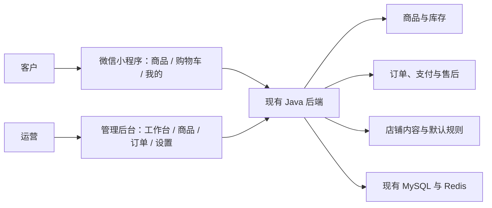
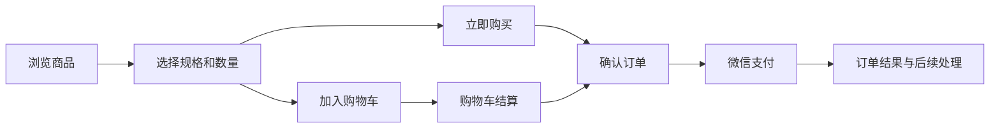

# Yuanmall 自营微信商城精简设计

- 日期：2026-11-13（北京时间）
- 状态：设计草案；商品直达首页与三项底部导航已实现首版，其他页面及后端精简尚未实施
- 适用范围：`yudao-mall-uniapp`、`yudao-ui-admin-vue3`、`ruoyi-vue-pro`

## 1. 目标与业务边界

已经确认的经营模式是：**我们自己卖货，客户直接购买。** 本次设计以减少客户操作、运营配置和日常维护负担为目标。

客户的主要任务是找商品、购买和查看订单；运营的主要任务是发布商品、发货和处理售后。系统围绕这两组任务组织页面和功能。

本设计采用现有 uni-app + Vue 3 小程序、Vue 3 管理后台和 Java 后端作为实现基础。客户入口为微信小程序，管理后台用于电脑端运营。

首版的界面目标：

| 对象 | 目标 |
| --- | --- |
| 客户导航 | 商品、购物车、我的，三个底部入口 |
| 普通商品发布 | 一个页面完成，主要填写图片、名称、售价、库存和描述 |
| 普通订单结算 | 一个确认页展示商品、收货信息、运费和实付金额 |
| 日常后台 | 工作台、商品、订单、设置，四个一级入口 |
| 运营待办 | 优先展示待发货和待售后，支持直接进入处理 |
| 页面维护 | 运营可修改 Banner、公告、展示商品和客服信息 |

快递发货作为本文的默认履约示例。实际是否以快递或自提为主、运费如何计算，需要在实施前结合现有经营方式确定。

首版范围聚焦自营商品交易。商家入驻、团长发布、活动报名、票务、座位和签到不纳入本轮建设。

## 2. 当前实现与精简切入点

2026-11-13 首版进展：本机商品首页改为固定的搜索、一级分类和单列商品列表，读取现有商品接口；首页不再渲染营销装修组件。底部导航固定为商品、购物车、我的，分类页保留为普通页面，原有商品详情、结算、个人中心和历史业务页面继续复用。此次未部署后端或上传微信版本。

本轮验证：`pnpm test:catalog` 四项通过，覆盖初始化先于商品请求、分类请求乱序、分页重试和搜索清空；公网商品/分类/分页/空搜索接口成功。持续编译已更新 `unpackage/dev/mp-weixin`，生成的首页、底部导航、初始化和应用入口 JS 语法检查通过，生成配置仅有三个 Tab。屏幕读取工具超时，尚未完成本轮模拟器目视、真机及支付验收。

以下为本地源码核对结果，不能据此推断生产环境实际配置、业务使用量或第三方服务开通状态。

| 当前实现 | 对精简的影响 | 源码依据 |
| --- | --- | --- |
| 小程序使用 Vue 3 和 Pinia | 可以沿用现有页面和状态管理 | [main.js](../main.js)、[package.json](../package.json) |
| 首版首页已固定结构，个人中心仍通过装修组件渲染 | 全局初始化和个人中心仍依赖模板数据，后续继续整理配置来源 | [首页](../pages/index/index.vue)、[个人中心](../pages/index/user.vue)、[应用初始化](../sheep/store/app.js) |
| 商品发布分为基础设置、价格库存、物流设置、商品详情、其它设置五个页签 | 普通商品需要填写较多通用配置 | [商品发布表单](../../yudao-ui-admin-vue3/src/views/mall/product/spu/form/index.vue) |
| 结算页包含积分、优惠券及不同订单类型分支 | 应按首版经营规则收敛展示和计算入口 | [确认订单](../pages/order/confirm.vue) |
| 后台订单列表提供多种筛选条件 | 日常发货需要更直接的待办入口 | [订单管理](../../yudao-ui-admin-vue3/src/views/mall/trade/order/index.vue) |
| 交易模块依赖营销模块，装修接口也属于营销模块 | 裁剪营销功能时需要先整理依赖 | [交易模块依赖](../../ruoyi-vue-pro/yudao-module-mall/yudao-module-trade/pom.xml)、[装修 API](../sheep/api/promotion/diy.js) |
| 多个通用业务模块已经在根 POM 中注释 | 第一轮精简重点应放在商城内部的页面、规则和依赖 | [后端根 POM](../../ruoyi-vue-pro/pom.xml) |
| 微信发货同步和确认收货已有代码 | 可复用现有实现，仍需验证运行配置与实际订单链路 | [微信订单同步](../../ruoyi-vue-pro/yudao-module-mall/yudao-module-trade/src/main/java/cn/iocoder/yudao/module/trade/service/order/handler/TradeStatusSyncToWxaOrderHandler.java)、[收货确认](../pages/order/detail.vue) |

小萝卜报名的参考价值在于围绕高频任务组织操作。此次精简不引入其报名、票务或主办方业务模型，也不依赖其解包代码和素材。

## 3. 首版功能取舍

本节描述目标范围。实施前需要盘点当前在用功能、未完成订单及用户已有权益。

| 功能 | 首版处理 |
| --- | --- |
| 商品、规格、价格、库存、上下架 | 保留；普通商品默认单规格，多规格按需展开 |
| 浏览、搜索、分类 | 保留；分类和搜索放在商品页内 |
| 购物车、多商品合单 | 保留；支持直接购买和购物车结算两条路径 |
| 登录、地址、客服 | 保留；浏览商品无需先登录，在购买等必要环节完成登录 |
| 普通订单、微信支付、物流、退款售后 | 保留，构成完整交易流程 |
| 首页和个人中心 | 固定结构，保留少量内容配置 |
| 优惠券、积分、等级 | 首版默认不新增此类经营活动；已有权益按原有有效规则处理 |
| 秒杀、拼团、砍价、积分兑换、分销及佣金 | 首版关闭新业务入口；历史订单与记录继续可处理 |
| 余额充值、钱包及提现 | 首版不作为新的购买路径；已有余额、退款和资金记录需要专项兼容 |
| 多租户与平台管理 | 日常运营使用当前自营店铺上下文；底层租户隔离和权限机制继续复用 |
| 打单服务 | 先明确实际发货量和人工步骤，再决定是否接入一家服务 |
| H5 商城及其他客户端 | 本轮面向微信小程序，沿用仓库现有运行和发布约定 |

关闭一项业务包括入口、路由、后端新业务请求和运营配置四个方面。历史订单查询、履约、退款和有效权益处理单独保留，不能通过统一拒绝旧订单类型来完成关闭。

## 4. 总体结构

图中的商品、交易和店铺规则是职责划分，复用现有模块与部署方式，不表示新增独立服务。

后端负责可购买状态、价格、库存、运费、权限和订单状态；小程序和管理后台负责展示与操作。页面精简与后端规则调整一起交付，避免将隐藏字段变成提交时的隐性必填项。

配置优先复用已有能力。新增配置只用于确有需要的店铺内容和默认规则，不再建设一套通用配置平台。接口优先复用现有业务接口，缺口在对应阶段明确后再补充。

## 5. 客户小程序设计

### 5.1 页面组织

| 页面 | 主要内容与操作 | 现有位置 |
| --- | --- | --- |
| 商品首页 | 店铺标识、Banner、公告、搜索、分类和商品列表 | [pages/index/index.vue](../pages/index/index.vue) |
| 商品详情 | 图片、名称、实际售价、规格、库存提示、描述、客服和购买按钮 | [pages/goods/index.vue](../pages/goods/index.vue) |
| 购物车 | 数量修改、失效商品提示、勾选商品和结算 | [pages/index/cart.vue](../pages/index/cart.vue) |
| 确认订单 | 商品、地址或自提信息、配送费用、应付金额和支付按钮 | [pages/order/confirm.vue](../pages/order/confirm.vue) |
| 我的 | 订单入口、地址、客服和必要的账号设置 | [pages/index/user.vue](../pages/index/user.vue) |
| 订单列表与详情 | 支付状态、履约状态、物流、收货确认和售后入口 | [pages/order](../pages/order/) |

分类和搜索继续复用现有页面或组件，入口集中在商品首页。地址编辑和客服作为任务页面按需进入。

### 5.2 购买流程

交互要求：

- 单规格商品默认选中规格，客户只需调整数量。
- 已有收货地址时自动带入，并允许修改；缺少地址时在确认订单环节补全。
- 商品只支持一种履约方式时自动使用该方式；支持多种时再展示选择。
- 用户取消支付后可从订单中继续支付，支付结果异常时展示可恢复的订单状态。
- 登录和授权完成后回到原购买位置，保留已选规格、数量及结算上下文。
- 运费和实付金额在支付前明确展示。后端重新结算后如金额发生变化，需更新展示并由客户确认。
- 仅在相关操作发生时申请地址、定位等权限；定位失败不能阻断普通商品购买。

### 5.3 固定页面与内容配置

固定首页和个人中心的结构。运营维护 Banner、公告、展示商品、客服和店铺基本信息。

过渡阶段复用现有装修接口的数据，把已用内容映射到固定页面。页面提供默认结构和空状态；模板缺失时仍可使用正常的商品浏览入口。配置缓存用于恢复展示，结算金额与库存始终由后端确认。

后续再评估将必要内容迁移到简单的店铺配置接口。迁移后统一配置来源，结束对旧模板的运行依赖，再收缩装修编辑器和关联代码。

## 6. 运营后台设计

### 6.1 四个一级入口

| 入口 | 内容 |
| --- | --- |
| 工作台 | 待发货、待售后、库存预警、当天订单和销售概览；直接进入待办 |
| 商品 | 新建、编辑、上下架、库存调整、商品搜索 |
| 订单 | 待发货、配送中、已完成、售后；其他订单状态可筛选查看 |
| 设置 | 店铺内容、客服、默认分类、配送与运费、必要的账号权限配置 |

售后在订单入口内形成独立待办。底层订单状态沿用现有定义，列表分组通过查询条件和聚合实现。

普通运营角色按工作任务授予菜单、路由和接口权限。系统维护功能保留专用权限入口，避免所有运营账号默认使用超级管理员。

### 6.2 简版商品发布

默认单页展示图片、名称、售价、库存、描述和上下架状态。多规格及特殊配送配置在当前页面按需展开。

| 字段或规则 | 处理方式 |
| --- | --- |
| 主图与轮播图 | 一次上传图片，首张默认作为封面，允许调整顺序 |
| 名称、售价、库存 | 运营填写；金额沿用现有元展示、分存储规则 |
| 描述 | 支持文字与图片；校验要求与后台接口同步调整 |
| SKU | 新商品默认一个规格；已有多规格商品保留 SKU 标识和原有结构 |
| 分类、配送方式和运费模板 | 使用已配置的有效店铺默认值，允许按商品覆盖 |
| 品牌、关键词和简介 | 按实际使用决定是否保留；同步处理前后端校验与既有数据 |
| 分销、赠送积分和虚拟销量 | 新商品使用首版明确的关闭或零值规则，运营无需重复填写 |
| 重量、体积 | 运费规则依赖时才要求填写，沿用现有单位 |
| 成本价等事实字段 | 有真实数据时填写；缺失值语义和统计口径需要明确，不伪造业务数据 |

默认值由后端统一应用和校验，管理后台负责展示实际生效结果。默认分类或运费模板不存在、已停用时，给出明确的设置入口。

编辑已有商品时读取原有数据，仅修改提交的字段。不能因使用简版表单而清空既有规格、覆盖历史配送规则或重置业务数据。

### 6.3 发货与售后

发货流程：打开待发货列表 → 查看订单 → 选择快递公司并填写运单号 → 确认发货 → 查看结果。

首版复用现有单笔发货能力。订单规模产生实际需要后，再补批量处理或第三方打单；届时需同时完成运单回传、订单对应和失败处理。

售后流程：打开待售后列表 → 查看申请与订单 → 按已有售后类型处理 → 查看退款或退货结果。

订单发货和微信发货同步分别记录结果。同步失败应可发现和重试，运营能够区分本系统已发货与微信同步成功。退款通过原有支付和售后流程处理。

## 7. 后端与数据设计原则

1. 复用商品、会员、交易、支付、系统和基础设施模块，按需求整理依赖。
2. 保留现有租户上下文、数据隔离、登录和权限机制。自营店铺与当前微信 AppID 的绑定沿用有效配置。
3. 价格、运费、库存和优惠资格由后端计算。关闭新营销活动时同步限制对应新请求，继续处理历史有效权益。
4. 沿用订单、支付、退款的状态流转、库存处理、回调和重复请求保护。页面展示分组不改变这些规则。
5. 历史商品、订单、支付、退款、余额和权益数据保留业务含义。字段或接口调整采用兼容迁移。
6. 商品发布默认值、字段可选性和旧接口行为配套调整，避免只有某个前端能够正确创建商品。
7. 先梳理交易模块对营销模块的依赖、装修接口和价格计算，再移除不再使用的代码与构建依赖。
8. 保持现有总仓库与三个源码目录结构，改动集中在明确的业务页面和服务，便于后续同步上游。

微信发货同步在本地基础配置中已有启用项，小程序也有确认收货组件调用。实施时仍需核对运行环境覆盖配置、接口返回数据及真实订单结果，分别记录代码存在、运行启用和业务验证情况。

## 8. 实施顺序与交付物

| 阶段 | 工作内容 | 完成标志 |
| --- | --- | --- |
| P0：盘点与规则确定 | 统计在用页面和功能，梳理未完成订单及已有权益，确定主要履约方式、运费规则和店铺默认值 | 形成保留、关闭新业务、历史兼容清单 |
| P1：运营流程精简 | 简版商品发布、四个后台入口、待发货与待售后工作台；配套默认值和字段校验 | 普通商品单页发布，运营可从待办直接处理订单 |
| P2：客户流程精简 | 三个底部入口、固定首页和我的、简版结算；收敛营销入口和新请求规则 | 直接购买与购物车结算均完成完整交易流程 |
| P3：配置与代码收缩 | 统一店铺内容来源，结束旧装修运行依赖，清理无用路由和构建依赖 | 依据引用和验证结果确认被移除能力已无运行依赖 |

P1、P2 每批改动都配套处理相关后台规则、接口与历史兼容，避免将所有后端调整推迟到 P3。

代码裁剪依据当前实际启用、依赖分析和业务验证结果进行。源码目录数量、菜单数量、构建产物和服务资源使用分别衡量，避免混为同一个精简指标。

## 9. 验证与验收

以下为后续实施的验收要求，不代表本文编写时已经完成验证。

| 场景 | 验收要求 |
| --- | --- |
| 普通商品发布 | 在一个页面完成创建、编辑、上下架和库存维护；隐藏字段不会导致保存失败 |
| 已有多规格商品 | 编辑后 SKU 标识、规格、库存及非本次修改数据保持正确 |
| 浏览与登录 | 未登录可浏览；登录后恢复原购买上下文；权限拒绝有可继续的路径 |
| 两种购买入口 | 立即购买、购物车多商品结算均正确展示商品、数量和金额 |
| 地址与运费 | 新增或切换地址后重新计算运费；默认配置缺失时提示明确 |
| 价格与库存变化 | 后端拒绝无效提交，客户得到明确提示并可重新确认 |
| 支付 | 成功、取消、失败、结果延迟和重复通知下订单状态与库存正确 |
| 发货与收货 | 本系统发货、微信同步、物流查询、确认收货分别可核对结果 |
| 售后与退款 | 适用的售后类型、退款成功及异常处理沿用有效业务规则 |
| 历史业务 | 旧营销订单、已有优惠券、积分和余额按兼容方案查询及处理 |
| 运营权限 | 菜单、路由和接口权限一致，普通运营只访问获授权操作 |
| 展示配置 | 修改 Banner、公告、商品展示和客服信息后，固定页面正确生效 |
| 异常恢复 | 空商品、配置缺失、接口失败和网络异常时可理解并可恢复 |

实施前记录发布商品的必填项与操作次数、普通下单的页面跳转、每日发货和售后处理步骤。实施后对同一场景复测；速度和包体收益以实际测量为准。

验证分层记录源码检查、构建、微信开发者工具、真机以及运行环境业务结果。编译成功不等同于真实支付、发货、退款或发布验证完成。

## 10. 开发、交付与回退

- 遵循总仓库 [AGENTS.md](../../AGENTS.md)，保留用户已有改动和现有目录结构。
- 小程序修改落在源码与构建配置，生成目录 `unpackage/` 仅用于验证和上传。
- 本地后端和管理后台使用现有启动方式；管理后台开发端口为 `127.0.0.1:5300`。
- 微信开发与发布构建沿用 `dev:mp-weixin`、`build:mp-weixin` 及 `--mode wechat`，检查最终生效的接口地址。
- 小程序、管理后台、后端和可能的数据迁移分别列出交付内容，按接口兼容性安排顺序。接口扩展先可用，前端切换后再清理旧依赖。
- 数据迁移只处理明确需要的配置与字段，保留现有 MySQL、Redis 和业务数据状态；回退前核对新旧代码的数据兼容性。
- 每批变更记录涉及的页面、配置、接口及回退方式。生产部署、微信上传、提交审核和发布按仓库既有授权规则执行。

## 11. 实施前需要补齐的信息

| 信息 | 用途 |
| --- | --- |
| 主要履约方式及运费规则 | 决定结算字段、商品默认值与发货操作 |
| 当前商品数量及多规格占比 | 决定分类、批量操作与规格编辑的优先级 |
| 当前营销、优惠券、积分和钱包实际使用情况 | 确定新业务关闭范围及已有权益兼容方式 |
| 当前订单量、发货与售后人工步骤 | 判断待办、批量发货与第三方打单的需求 |
| 当前微信支付和发货同步的运行结果 | 安排验证与修复，避免将已有代码当作已完成接入 |
| 日常运营人员和职责 | 配置最小可用的菜单与操作权限 |

这些信息在相应阶段从现有配置、业务记录和运营流程中核实；会影响业务处理的规则在实施前明确。
