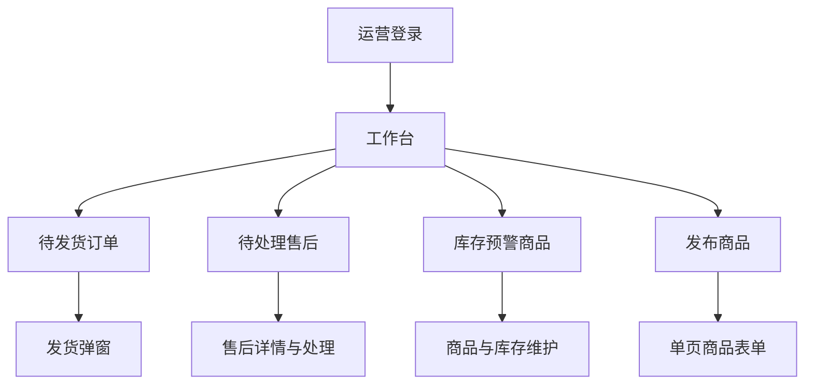

# Yuanmall 管理后台精简设计

- 版本：V1 设计草案
- 日期：2026-11-13（北京时间）
- 状态：待实施；本文不表示相关页面、接口或生产配置已经变更
- 经营模式：自营卖货，客户通过微信小程序直接购买
- 适用项目：`yudao-ui-admin-vue3`，必要时配套调整 `ruoyi-vue-pro`
- 总体设计：[DESIGN_YUANMALL.md](../../yudao-mall-uniapp/docs/DESIGN_YUANMALL.md)

## 1. 设计目标

将管理后台收敛为日常经营工具，让运营围绕发布商品、处理发货和售后完成工作。

第一版以减少操作步骤、表单字段、页面跳转和配置负担为主。沿用现有 Vue 3、TypeScript、Element Plus 和 Java 业务接口，按需调整页面与服务。

| 目标 | 第一版结果 |
| --- | --- |
| 导航清楚 | 日常运营只看到工作台、商品、订单、设置四个一级入口 |
| 任务直接 | 登录后立即看到待发货、待售后和库存预警，并能进入对应列表 |
| 发布简单 | 普通商品在一个页面完成发布，多规格按需展开 |
| 发货直接 | 待发货订单直接显示发货按钮，复用现有发货弹窗 |
| 查询集中 | 常用搜索和状态分组常驻，其他条件展开后使用 |
| 设置稳定 | 运营修改少量店铺内容和默认规则，系统配置交由维护人员处理 |
| 数据可信 | 统计来自有效业务接口，加载中、零值、无权限和失败分别展示 |

## 2. 当前源码事实

以下结论来自本地静态代码检查。当前生产账号实际看到的菜单、角色权限及业务数据需要在实施阶段核对。

| 当前实现 | 精简方向 | 源码依据 |
| --- | --- | --- |
| 默认 `/index` 指向通用首页，另有商城概览 | 统一日常首页为经营工作台，兼容旧链接 | [基础路由](../src/router/modules/remaining.ts)、[通用首页](../src/views/Home/Index.vue)、[商城概览](../src/views/mall/home/index.vue) |
| 商城概览包含会员分析、终端分布和多种趋势统计 | 首屏优先展示待办与少量经营数据 | [商城概览](../src/views/mall/home/index.vue) |
| 运营卡片中待发货、退款中的初始值分别为 `9`、`4` | 去除示例初始数值，明确各类请求状态 | [运营数据卡片](../src/views/mall/home/components/OperationDataCard.vue) |
| 商品发布包含五个页签，基础表单要求分类、品牌、关键词、简介等字段 | 建立单页发布和有效默认值，配套调整校验 | [发布表单](../src/views/mall/product/spu/form/index.vue)、[基础信息](../src/views/mall/product/spu/form/InfoForm.vue) |
| 订单列表展示多种筛选条件，发货操作位于“更多”中 | 保留常用条件，直接展示任务按钮 | [订单列表](../src/views/mall/trade/order/index.vue) |
| 已有单笔发货弹窗、订单详情和售后页面 | 优先复用现有业务能力 | [发货弹窗](../src/views/mall/trade/order/form/OrderDeliveryForm.vue)、[订单详情](../src/views/mall/trade/order/detail/index.vue)、[售后列表](../src/views/mall/trade/afterSale/index.vue) |
| 顶部集成多语言、尺寸、布局设置等通用工具 | 固定日常使用布局和语言，收敛工具栏 | [顶部工具栏](../src/layout/components/ToolHeader.vue)、[界面状态](../src/store/modules/app.ts) |
| 动态路由使用登录后缓存的角色菜单数据，另有静态基础路由 | 配套处理角色菜单、静态路由和接口权限 | [权限路由](../src/store/modules/permission.ts)、[基础路由](../src/router/modules/remaining.ts) |

`9`、`4` 是当前代码初始值，不代表真实订单数量。源码中保留某项功能，也不代表该功能当前在线上已启用。

## 3. 第一版范围

### 3.1 本轮交付

1. 四个一级入口和固定的简洁后台布局。
2. 唯一经营工作台，支持从待办进入带筛选条件的列表。
3. 单页商品发布、现有商品编辑、上下架和库存维护。
4. 订单常用查询、直接发货、售后入口与返回列表状态恢复。
5. 店铺内容、配送默认规则和必要的运营账号设置。
6. 菜单、路由、按钮与后端权限一致，覆盖已有数据与链接的兼容。

### 3.2 后续按需建设

复杂经营分析、会员运营、营销活动、钱包充值、分销佣金、第三方批量打单和多商家管理均不作为第一版新增能力。

已有权益、历史订单、售后及资金记录保留处理路径。实际在用功能的收敛顺序，在实施前结合业务记录确定。

源码与构建依赖的全面裁剪安排在核心页面稳定后。第一版按页面运行需要移除无关引用，不批量删除通用模块或修改订单、支付和退款的状态定义。

## 4. 信息结构与页面布局

### 4.1 四个一级入口

| 入口 | 页面内容 | 常用操作 |
| --- | --- | --- |
| 工作台 | 待发货、待售后、库存预警、今日成交概览 | 去发货、处理售后、补库存、发布商品 |
| 商品 | 商品列表、单页发布、分类与库存维护入口 | 搜索、编辑、上下架、调整库存 |
| 订单 | 订单列表、订单详情、发货、售后列表与详情 | 查订单、发货、看物流、处理售后 |
| 设置 | 店铺内容、客服、默认分类、配送运费、必要账号权限 | 修改内容与默认规则 |

客户资料随订单展示，需要时可查看该客户的相关订单。第一版不新增独立的会员运营中心。

### 4.2 固定后台布局

- 固定中文、左侧导航和统一视觉样式。
- 顶部主要保留店铺标识、当前页面位置和账号入口；待办通知与实际业务关联后使用。
- 日常运营收起主题、布局、字号、多语言、全局菜单搜索及独立 IM 等通用工具。
- 第一版采用单个主内容区域，关闭多标签页；列表到详情的返回行为保留筛选、分页和可恢复的滚动位置。
- 未保存表单离开前提示，保存失败保留用户输入。
- 页面使用商品、规格、运费、订单等业务名称，减少 SPU、SKU、租户、支付渠道等术语。
- 开发文档提示和示例内容退出日常运营页面。

布局调整需处理当前缓存的主题、布局等偏好，避免旧偏好覆盖新默认值。仅迁移相关界面配置，登录凭据及其他业务缓存继续按原规则管理。

## 5. 工作台

工作台首先回答“现在需要处理什么”，其次展示当天经营情况。

| 区域 | 展示与交互 |
| --- | --- |
| 待发货 | 显示可发货订单数量，点击进入对应状态的订单列表 |
| 待售后 | 显示当前运营需要处理的售后数量，点击进入相应待办 |
| 库存预警 | 显示触发预警的商品数量，点击进入商品列表 |
| 今日成交 | 展示今日支付成功订单数和实付金额，统计口径在页面说明 |
| 快捷操作 | 发布商品、查看订单，按权限显示 |

“待售后”需按现有状态和操作权限定义，区分待审核、待收货、待退款等需处理任务；退款正在渠道处理中等状态单独表达。

数据规则：

1. 数量与金额使用真实业务接口，不能用当前分页数据推算总量。
2. 加载中使用占位，成功返回的 `0` 才表示零；失败提供重试，未授权内容按权限处理。
3. 今日统计统一使用北京时间，明确按支付成功时间等哪一种业务时间统计；退款金额独立表达，不将实付总额标为净收入或利润。
4. 点击卡片携带明确的筛选参数，目标页面正确应用，用户可以看到并清除筛选条件。
5. 复用现有统计接口。若现有口径无法支撑待办或数据范围，补充相应聚合能力。
6. 组件初始化与重新激活的刷新统一管理，避免同一进入行为重复请求。

## 6. 商品管理与单页发布

### 6.1 商品列表

默认提供商品搜索和全部、在售、已下架、库存预警等分组，具体分组沿用有效的现有状态查询。

主要列为图片与名称、售价、库存、销售状态、操作。商品编号、创建时间和其他低频信息放入详情或高级区域。

常用操作为发布商品、编辑、上下架和库存维护。多规格商品的库存调整明确到规格；涉及数量变更时校验当前数据，避免完整旧快照覆盖其他字段。

### 6.2 发布表单

普通商品默认单规格，所有内容在一个页面完成。主要填写图片、名称、售价、库存和描述，多规格及特殊配送在当前页面按需展开。

| 字段或配置 | 第一版规则 |
| --- | --- |
| 图片 | 一次上传，首张默认作为主图，支持排序和更换 |
| 商品名称 | 运营填写，同时满足现有商品和规格名称要求 |
| 售价 | 运营填写，沿用元展示、分存储的金额约定 |
| 库存 | 运营填写，多规格时分别维护 |
| 描述 | 支持文字和图片，前后端采用一致的必填或可选规则 |
| 分类 | 使用有效店铺默认值，必要时选择其他分类 |
| 配送和运费模板 | 使用有效店铺默认规则，特殊商品可覆盖 |
| 品牌、关键词、简介 | 结合实际使用精简；配套处理现有必填校验和存量数据 |
| 多规格 | 新商品按需启用，已有多规格商品按原结构编辑 |
| 重量、体积 | 运费计算需要时才要求填写，单位沿用现有定义 |
| 分销、积分、虚拟销量 | 新商品使用首版明确的关闭或零值规则 |
| 成本价等事实字段 | 按真实数据填写，明确缺失值语义和统计口径 |

店铺默认值由后端统一应用和校验，前端展示最终结果。默认分类或模板无效时提示运营前往设置，不能让隐藏字段导致无法保存。

编辑已有商品时保留 SKU 标识、规格、配送覆盖项和未修改的数据。字段校验的变化需要核对已有接口调用方；默认值只在适用的新建或缺省场景生效。

保存按钮按实际语义区分保存、上架等操作，沿用现有状态与权限；不得在运营未选择时自动改变销售状态。

## 7. 订单、发货与售后

### 7.1 查询与列表

默认展示订单号／姓名／手机号搜索和时间范围。支付渠道、订单来源、订单类型、配送方式、快递公司及自提信息放入高级筛选。

订单列表提供全部、待付款、待发货、配送中、已完成等分组；售后作为订单入口内可直接访问的独立任务页。界面分组映射到现有查询条件，不新增业务状态。

主要展示商品与数量、收货人、实付金额、订单状态和可执行操作。完整地址、物流和客户资料在有权限的详情中查看。

### 7.2 直接发货

待发货订单按实际履约方式与权限直接展示发货或核销操作。“更多”保留备注等低频操作。

快递发货流程：

- 第一版复用现有发货弹窗，明确订单及收货信息，减少重新进入详情页的步骤。
- 发货所需字段按履约方式校验；有有效默认快递公司时可带入，运单号每笔填写。
- 提交中阻止重复点击，失败保留输入；刷新后以后端实际状态为准。
- 系统发货结果与微信同步结果分别表达，失败的同步任务可发现和恢复。
- 订单退款、取消或其他状态变化后，后端重新校验是否可发货。

### 7.3 售后处理与客户资料

优先复用现有售后列表与详情。运营从待办进入，查看申请、商品、金额和必要凭证后，执行该状态允许的审核、退货收货或退款操作。

退款结果沿用已有支付与售后规则。明确展示处理中、成功和失败，不能仅依据前端按钮提交成功显示退款完成。

客户信息在订单上下文中查询，访问范围由角色和后端数据权限控制。客户相关订单入口携带有效客户条件，返回时恢复原订单列表状态。

## 8. 设置与维护功能

日常设置分为店铺内容、经营默认规则和必要账号管理。

| 分类 | 内容 |
| --- | --- |
| 店铺内容 | 店铺名称、标识、Banner、公告、展示商品、客服信息 |
| 经营默认规则 | 默认分类、主要履约方式、运费模板、有效默认快递公司 |
| 账号管理 | 运营账号及其职责权限、个人资料、必要的密码或登录设置 |

店铺内容优先复用现有配置和装修数据，提供收敛后的表单。第一版只需维护固定页面使用的内容；完整装修编辑器的运行依赖整理与总体设计保持一致。

字典、菜单定义、租户维护、代码生成、支付渠道、接口文档、系统监控及部署配置作为维护人员的专用能力。支付等敏感配置仅通过现有受控能力维护，普通运营页面不增加凭据展示。

## 9. 权限、接口和历史兼容

### 9.1 权限规则

采用现有角色和权限机制，根据日常运营与系统维护职责配置范围。具体人员是否需要细分商品、发货、售后权限，在实施时按实际职责确认。

- 同步处理服务端角色菜单、前端动态路由、静态路由、按钮和接口权限。
- 旧 URL 访问仍执行授权校验，不能以隐藏菜单替代权限控制。
- 工作台数据和快捷操作按权限显示，接口同时控制数据范围与可执行动作。
- 按钮是否可用由订单状态、履约方式及操作权限共同决定，后端再次校验。
- 当前自营店铺沿用有效租户上下文和数据隔离，不通过删除租户参数获得简化效果。

### 9.2 接口复用与缺口

优先复用商品、订单、发货、售后、配置和统计接口。实施时重点检查以下缺口：

| 能力 | 核对与配套工作 |
| --- | --- |
| 工作台聚合 | 待办数量、权限范围、时间口径与目标列表一致 |
| 商品简版保存 | 默认值、前后端校验、字段更新语义及已有调用方兼容 |
| 库存局部修改 | 精确到商品或规格，避免使用完整旧表单覆盖其他数据 |
| 发货操作 | 状态校验、字段校验、重复请求保护和结果反馈 |
| 微信同步结果 | 核对现有可观测与重试能力，明确运营可见信息 |
| 店铺配置 | 固定页面使用的数据有统一、有效的读取与保存来源 |

该表是实施检查范围，不代表已有缺陷均已确认，也不要求无条件新增接口。

### 9.3 历史兼容

保留已有商品、订单、退款、权益、余额和必要操作记录的业务含义。日常功能收敛时，为已有业务提供有效处理路径。

通用首页和商城概览的旧入口统一指向新工作台。已有订单、商品和售后详情链接尽量保持可用；需要迁移的路由提供明确映射并继续鉴权。

## 10. 实施步骤

| 阶段 | 交付内容 | 配套要求 |
| --- | --- | --- |
| A0：核实与定稿 | 当前菜单权限、在用业务、默认分类、履约和运费清单 | 核对未完成订单及已有权益，确认统计口径 |
| A1：导航和工作台 | 四个入口、固定布局、唯一首页、真实待办及筛选跳转 | 菜单路由权限同步调整，覆盖旧布局偏好 |
| A2：商品发布 | 简版列表、单页表单、多规格编辑、上下架与库存维护 | 后端默认值、校验和更新语义一起交付 |
| A3：订单处理 | 常用筛选、直接发货、售后路径、列表返回恢复 | 操作状态及权限校验、异常反馈和历史兼容 |
| A4：设置与验收 | 收敛设置、店铺内容维护、端到端验证 | 配置来源一致，记录构建与业务验证结果 |

每批改动覆盖相关前后端行为，保持业务可操作。前端切换后，再依据实际引用和验证结果清理无用页面、静态路由及构建依赖。

## 11. 验收标准

以下是实施后的验收要求，当前仅完成设计。

| 场景 | 通过条件 |
| --- | --- |
| 登录与导航 | 日常运营进入唯一工作台，看到获授权的四类入口，其他能力按职责授权 |
| 工作台数据 | 成功、零值、加载、失败、无权限均表达正确，无示例数值冒充真实数据 |
| 待办跳转 | 卡片进入对应筛选列表，数量与查询口径可核对 |
| 发布普通商品 | 一张表单完成，缺省字段有有效规则，隐藏项不会阻断保存 |
| 编辑已有商品 | 保留原规格、SKU 标识及未修改字段，上下架状态符合操作意图 |
| 查询订单 | 常用条件可直接使用，高级筛选和历史订单仍可访问 |
| 发货与核销 | 按订单履约方式直接进入操作，失败保留输入，重复请求不重复执行 |
| 售后 | 当前状态允许的审核、退货与退款操作正确，异步结果表达准确 |
| 返回与未保存内容 | 列表筛选和分页恢复，未保存内容离开前提示 |
| 店铺设置 | 修改内容后客户小程序正确读取，默认规则对适用的新建业务生效 |
| 权限边界 | 隐藏入口的直接 URL、越权接口及非授权数据访问均受现有权限机制限制 |
| 小程序回归 | 商品展示、直接购买、购物车结算、支付、发货、收货和售后不因后台改造受损 |

实施前后记录同一任务的必填项、点击次数、页面跳转和请求情况。以真实操作比较精简效果，包体、加载速度和接口性能收益通过测量报告。

## 12. 开发与交付约定

- 遵循总仓库 [AGENTS.md](../../AGENTS.md)，保留现有目录结构、上游同步方式和用户已有改动。
- 本地管理后台沿用 `127.0.0.1:5300`；生产管理入口为 `https://mall.nexrur.ai/`，客户小程序接口和管理接口沿用既有路径约定。
- 按变更运行相应类型检查、构建与必要的业务验证，分别记录通过范围。
- 发布构建沿用 `build:mall` 和 `.env.mall`，检查实际生效配置，不提交密钥、令牌或运行日志。
- 前后端按接口兼容顺序交付，涉及菜单、配置或数据迁移时记录前值、变更范围和回退方法。
- 页面回退同时考虑角色菜单、缓存和接口兼容性，保留新产生业务数据的有效性。
- 本文交付为设计文档，实际代码实施和生产发布分别按后续任务及仓库授权规则执行。
